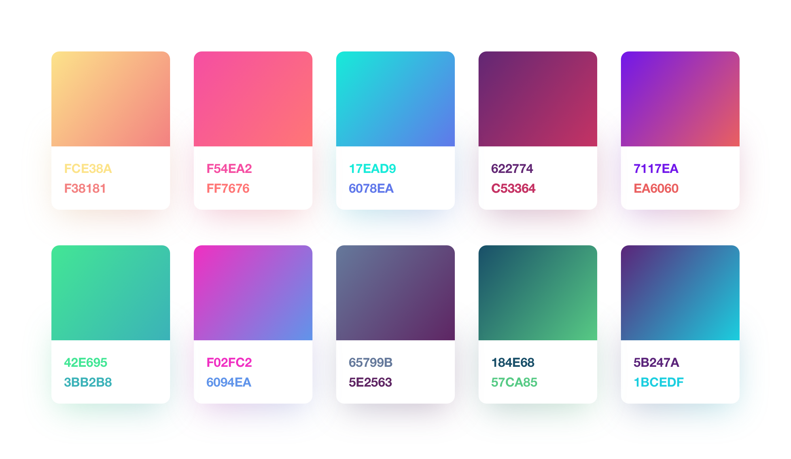

# Pastel
🎨 Gradient animation effect like Instagram


[](http://cocoapods.org/pods/Pastel)
[](http://cocoapods.org/pods/Pastel)
[](https://developer.apple.com/ios/)
[](https://swift.org/package-manager/)


## Requirements

- iOS 16.0+
- Swift 5.9+
- Xcode 15+

## Installation

### Swift Package Manager

Add Pastel to your `Package.swift`:

```swift
dependencies: [
    .package(url: "https://github.com/cruisediary/Pastel.git", from: "1.0.0")
]
```

Or in Xcode: **File → Add Package Dependencies** and enter the repository URL.

### CocoaPods

```ruby
pod 'Pastel', '~> 1.0.0'
```

## Usage

### SwiftUI

**Animated gradient background (preset)**

```swift
import SwiftUI
import Pastel

struct ContentView: View {
    var body: some View {
        Text("Hello")
            .pastelBackground(.instagram)
    }
}
```

**Animated gradient background (custom colors)**

```swift
Text("Hello")
    .pastelBackground(colors: [
        UIColor(red: 156/255, green: 39/255, blue: 176/255, alpha: 1),
        UIColor(red: 255/255, green: 64/255, blue: 129/255, alpha: 1),
        UIColor(red: 32/255, green: 76/255, blue: 255/255, alpha: 1)
    ], duration: 3.0)
```

**Animated gradient view**

```swift
PastelGradientView(gradient: .sunset, duration: 4.0)
    .ignoresSafeArea()
```

**Animated gradient text**

```swift
PastelText("Pastel", font: .largeTitle, gradient: .instagram)
```

**Shared state (coordinate multiple views)**

```swift
let state = PastelAnimationState(
    colors: [.purple, .pink, .blue],
    duration: 3.0,
    timingCurve: .easeInOut,
    repeatBehavior: .count(5),
    autoreverses: true
)

PastelGradientView(state: state)
PastelText("Hello", state: state)
```

### UIKit

**Basic usage**

```swift
override func viewDidLoad() {
    super.viewDidLoad()

    let pastelView = PastelView(frame: view.bounds)

    // Direction
    pastelView.startPastelPoint = .bottomLeft
    pastelView.endPastelPoint = .topRight

    // Duration
    pastelView.animationDuration = 3.0

    // Colors
    pastelView.setColors([
        UIColor(red: 156/255, green: 39/255, blue: 176/255, alpha: 1),
        UIColor(red: 255/255, green: 64/255, blue: 129/255, alpha: 1),
        UIColor(red: 123/255, green: 31/255, blue: 162/255, alpha: 1),
        UIColor(red: 32/255, green: 76/255, blue: 255/255, alpha: 1),
        UIColor(red: 58/255, green: 255/255, blue: 217/255, alpha: 1)
    ])

    pastelView.startAnimation()
    view.insertSubview(pastelView, at: 0)
}
```

**Shared state with UIKit**

```swift
let state = PastelAnimationState(
    colors: [.purple, .pink, .blue],
    duration: 3.0,
    timingCurve: .easeInOut
)

let pastelView = PastelView(frame: view.bounds)
pastelView.animationState = state
pastelView.startAnimation()
view.insertSubview(pastelView, at: 0)
```

## 🎨 Gradient Presets

30 built-in presets available via `PastelGradient`.

#### Designed by Alexander Zaytsev — https://dribbble.com/anwaltzzz


## Example Project

Clone the repo and open `Example/Pastel.xcodeproj`. No additional setup needed — Pastel is linked via SPM automatically.

## Author

cruz, cruzdiary@gmail.com

## Thanks

Many thanks to [**the contributors**](https://github.com/cruisediary/Pastel/graphs/contributors) of this project.

## License

Pastel is available under the MIT license. See the LICENSE file for more info.
